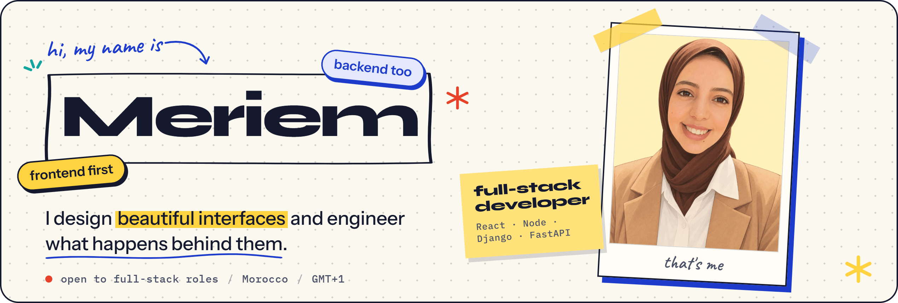

  

# Hi there, I'm Meriem Tijani! 👋

## About Me 🚀

I'm a **Full-Stack Developer** based in Morocco who designs interfaces and engineers what happens behind them. I take complicated things apart, then put them back together so they feel simple.

**Frontend is my strongest side:** I like deciding how a product should work before deciding how it should look, then building the interface with the same care as the data model behind it. On the frontend I work with **React**, **Next.js**, **TypeScript** and **Tailwind CSS**. On the backend I build APIs with **Node.js & Express**, **Django** and **FastAPI**, on **PostgreSQL**, **MySQL**, **MongoDB** and **Redis**.

I'm a **Software Developer at FlexBusiness** (Tangier), working on a document-processing platform and a multi-role delivery back-office, and I built the public sites for **[FlexDok](https://flexdok.com)** and **[fl-x.com](https://fl-x.com)**.

- 🌱 **Learning:** Master in Software Engineering & Web Applications at ENSI, Tangier
- 🔭 **Building:**
  - **CareerPulse AI** — a career command center: applications, resume analysis, interview prep and market signals in one place
  - **The FlexDok website** — the public site for an online document editor, in four languages
- 🧩 **Main Stack:** React, Next.js, TypeScript, Tailwind CSS, Node.js, Express, Django, FastAPI, PostgreSQL, Redis, Docker
- 🌍 **Languages I speak:** JavaScript, TypeScript, Python, PHP, SQL, C# | Arabic, French, English
- ⚡ **Approach:** Simple code. Clear logic. Impactful results.
- 💼 **Open to:** full-stack roles

---

## 📂 Featured Projects

| Project | What it is | Built with | |
| --- | --- | --- | --- |
| **CareerPulse AI** | Applications, resume analysis, interview prep and market signals. Every AI call runs in a background worker, so requests never block | React, FastAPI, PostgreSQL + pgvector, Redis, Celery, Docker | [Code](https://github.com/Mariemtijani/CareerPulse-AI) |
| **Mail Cleanup** | Sorts the inbox with AI, unsubscribes in bulk and cleans up on a schedule, with live progress over WebSockets | React, TypeScript, Node.js, Express, BullMQ, Redis, Socket.io | [Code](https://github.com/Mariemtijani/mail-cleanup) |
| **Artisan Marketplace** | The GraphQL API behind an e-commerce platform for Moroccan artisans and associations (ALX Backend Development Program) | Django, Graphene, PostgreSQL, JWT, Docker | [Code](https://github.com/Mariemtijani/alx-project-nexus) |
| **Book Heaven** | A library web app: reservations, accounts, inventory and reading stats | Laravel, PHP, MySQL, Blade | [Code](https://github.com/Mariemtijani/book_store) |
| **FlexDok website** | The public site for FlexDok, in English, French, Spanish and Arabic (right to left), prerendered for search engines | React, Vite, Tailwind CSS, Framer Motion | [Live](https://flexdok.com) |
| **Flex Business website** | The company site, rebuilt in Next.js 16, with digital business cards (QR code → contact page → saved vCard) | Next.js, TypeScript, Tailwind CSS | [Live](https://fl-x.com) |

---

## 🛠️ Skills & Tools

**Frontend:**

**Backend:**

**Databases:**

**Dev Tools & Others:**

---

## 💡 What I Enjoy Working On

- Building **interfaces** with the same care as the **data model** behind them
- Designing **APIs and async systems**: queues, background workers, Server-Sent Events and WebSockets
- **Data modelling**: planning the schema before writing the code
- **AI integration** designed into the product, not bolted on
- **Multilingual, accessible** front ends, right-to-left included
- Taking a product from **Figma designs to working features**

---

## 🎓 Education & Certifications

- 🎓 **Master in Software Engineering & Web Applications** — ENSI, Tangier *(Dec 2025 – present)*
- 🎓 **European Bachelor (FEDE) in Software Development & Networks** — IKI Group, Tangier *(2024)*
- 🎓 **Technician Specialist in Full Stack Web Development** — ISMONTIC, Tangier *(2022 – 2024)*
- 📜 **Backend Development Program** and **Professional Foundations** — ALX Africa *(2025)*

---

## 📫 Let's Connect

